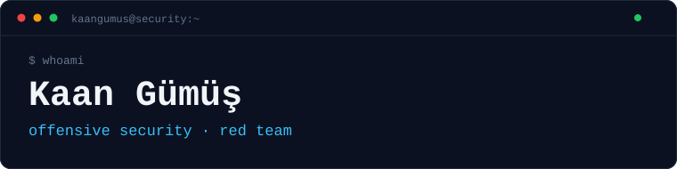

<picture>
  <source media="(prefers-color-scheme: dark)" srcset="assets/banner-dark.svg">
  <source media="(prefers-color-scheme: light)" srcset="assets/banner-light.svg">
  
</picture>

### Offensive security practitioner focused on Active Directory, web applications, and internal networks.

I build small tools for the repetitive parts of security assessments, and labs to understand the techniques behind them. Clear notes, reproducible findings, and practical impact matter more than checklist-only testing.

`active directory` · `web security` · `internal pentesting` · `privilege escalation` · `bug bounty recon`

> Enumerate deeply. Document clearly. Automate carefully.

---

## 01 — Profile

My work sits between **offensive security** and **tooling**: Active Directory attack paths, web application testing, internal network assessments, privilege escalation, and lateral movement. I use labs to validate techniques before applying them in authorized environments.

When a workflow repeats, I turn it into a small, reliable tool.

---

## 02 — Current Work

**LOXS 2.1.1** — a JavaFX desktop web vulnerability scanner for **SQLi**, **LFI**, **CRLF**, **XSS**, and **open redirect** testing.

`Windows MSI` · `Linux` · `HTML / CSV / JSON reports`

[Source](https://github.com/kaaangumus/loxs) · [Release](https://github.com/kaaangumus/loxs/releases/tag/v2.1.1)

---

## 03 — Selected Work

| # | Project | Focus | Stack |
|:--|:--|:--|:--|
| 01 | **[LOXS](https://github.com/kaaangumus/loxs)** | Desktop web vulnerability scanner for SQLi, LFI, CRLF, XSS and open redirects. | `Java` `JavaFX` |
| 02 | **[palm](https://github.com/kaaangumus/palm)** | Bug bounty subdomain recon pre-filter for live hosts and takeover checks. | `Go` |
| 03 | **[montana-framework](https://github.com/kaaangumus/montana-framework)** | Searchsploit-like local exploit search tool for Kali/Linux. | `Go` |
| 04 | **[flask-ssti-lab](https://github.com/kaaangumus/flask-ssti-lab)** | Deliberately vulnerable Flask SSTI lab for local training. | `Python` |
| 05 | **[nhc](https://github.com/kaaangumus/nhc)** | Hash analysis and cracking utility for lab workflows. | `Python` |
| 06 | **[SFounder](https://github.com/kaaangumus/SFounder)** | Webshell discovery helper for authorized review scenarios. | `Python` |

---

## 04 — Toolkit

**Offensive** — Active Directory · Web applications · Internal networks · Privilege escalation · Lateral movement  
**Engineering** — Go · Java · JavaFX · Python · Bash  
**Environment** — Kali Linux · Burp Suite · Git · Gradle

---

## 05 — Contact

[Website](https://kaangumus.ninja) · [GitHub](https://github.com/kaaangumus) · [LOXS](https://github.com/kaaangumus/loxs)

Only test systems you own or have written authorization to assess.
