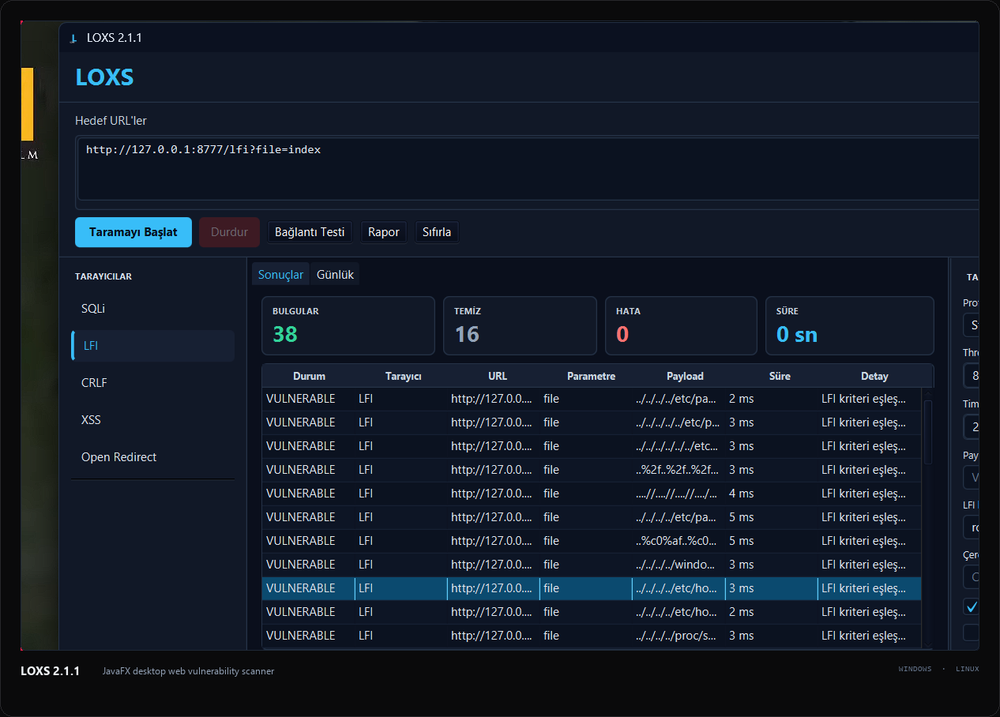

<picture>
  <source media="(prefers-color-scheme: dark)" srcset="assets/banner-dark.svg">
  <source media="(prefers-color-scheme: light)" srcset="assets/banner-light.svg">
  
</picture>

### Offensive security practitioner focused on Active Directory, web applications, and internal networks.

I build small tools for the repetitive parts of security assessments, and labs to understand the techniques behind them.

`active directory` · `web security` · `internal pentesting` · `privilege escalation` · `bug bounty recon`

---

## 01 — Selected Work

### [LOXS 2.1.1](https://github.com/kaaangumus/loxs)

A JavaFX desktop web vulnerability scanner for **SQLi**, **LFI**, **CRLF**, **XSS**, and **open redirect** testing.

Built for fast, repeatable checks:

- Native **Windows MSI** and **Linux** package
- Context-aware scanner settings
- HTML, CSV, and JSON reports
- Dark, responsive interface

[Source](https://github.com/kaaangumus/loxs) · [Release](https://github.com/kaaangumus/loxs/releases/tag/v2.1.1)

 

---

## 02 — Other Projects

| # | Project | Focus | Stack |
|:--|:--|:--|:--|
| 01 | **[palm](https://github.com/kaaangumus/palm)** | Bug bounty subdomain recon pre-filter for live hosts and takeover checks. | `Go` |
| 02 | **[montana-framework](https://github.com/kaaangumus/montana-framework)** | Searchsploit-like local exploit search tool for Kali/Linux. | `Go` |
| 03 | **[flask-ssti-lab](https://github.com/kaaangumus/flask-ssti-lab)** | Deliberately vulnerable Flask SSTI lab for local training. | `Python` |
| 04 | **[nhc](https://github.com/kaaangumus/nhc)** | Hash analysis and cracking utility for lab workflows. | `Python` |
| 05 | **[SFounder](https://github.com/kaaangumus/SFounder)** | Webshell discovery helper for authorized review scenarios. | `Python` |

---

## 03 — Toolkit

**Offensive** — Active Directory · Web applications · Internal networks · Privilege escalation · Lateral movement  
**Engineering** — Go · Java · JavaFX · Python · Bash  
**Environment** — Kali Linux · Burp Suite · Git · Gradle

---

## 04 — Contact

[Website](https://kaangumus.ninja) · [GitHub](https://github.com/kaaangumus) · [LOXS](https://github.com/kaaangumus/loxs)

Only test systems you own or have written authorization to assess.

